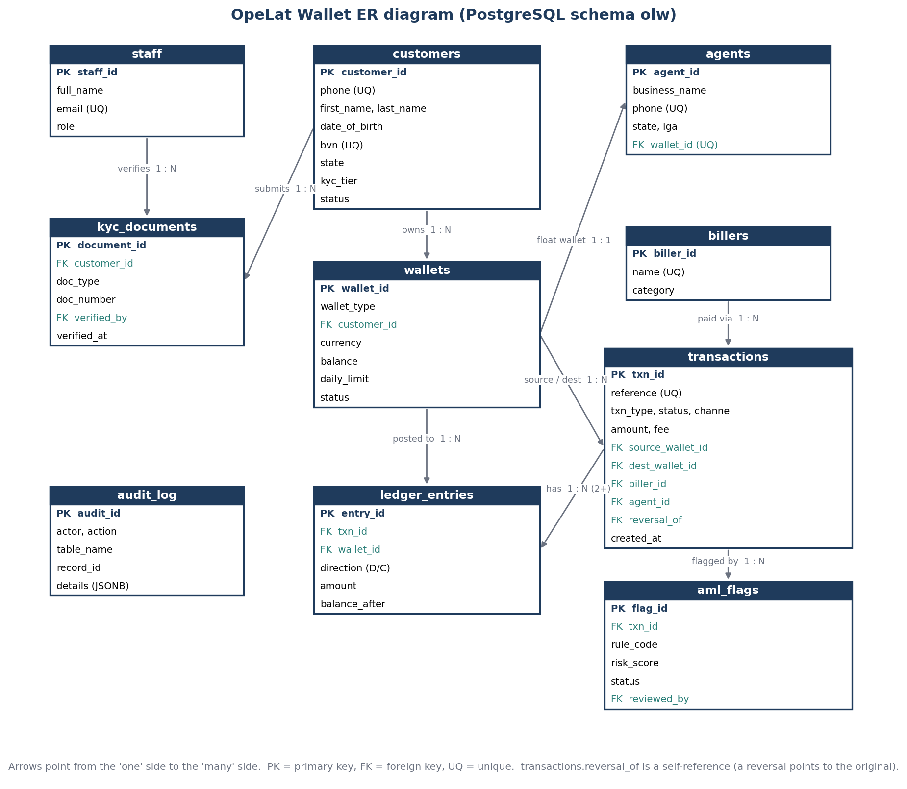
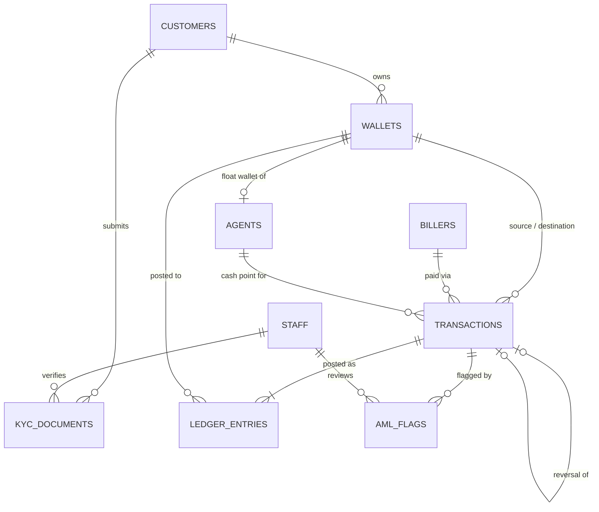
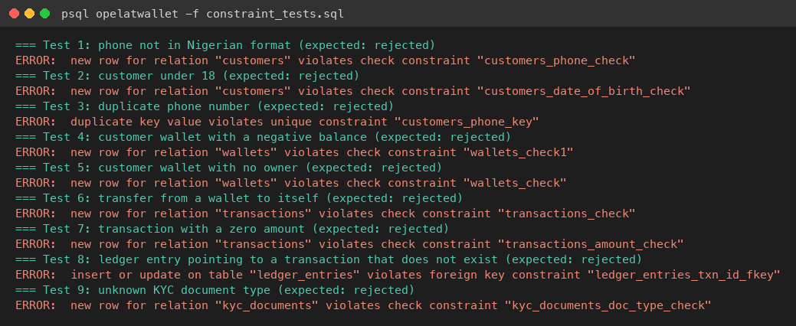

# Portfolio 1: Database Design and Modelling (7 marks)

## What the brief asks for

Chosen case study description, ER diagram, relational schema, keys, constraints, and a normalisation explanation.

## Checklist

- [x] Case study description (see the [main README](../README.md#case-study-opelat-wallet))
- [x] ER diagram: [`er-diagram.png`](er-diagram.png) (drawn by [`tools/draw_er_diagram.py`](../tools/draw_er_diagram.py)) and the Mermaid version below
- [x] Relational schema as SQL: [`schema.sql`](schema.sql) (10 tables, schema `olw`)
- [x] Constraints: NOT NULL, UNIQUE, CHECK, foreign keys with ON DELETE rules, plus a trigger and an integrity view
- [x] Normalisation explanation (below)
- [x] Evidence: [`evidence/schema_in_postgres.txt`](evidence/schema_in_postgres.txt), [`evidence/constraint_tests_output.txt`](evidence/constraint_tests_output.txt) and [`screenshots/`](screenshots/)

## How to run

```bash
createdb opelatwallet                                              # once
psql opelatwallet -f portfolio-1-database-design/schema.sql        # build the schema
psql opelatwallet -f portfolio-1-database-design/constraint_tests.sql   # prove the constraints
```

## My work

### Entities and relationships





| Table | What one row means | Primary key | Main foreign keys |
|---|---|---|---|
| `customers` | One registered person | `customer_id` | none |
| `kyc_documents` | One identity document a customer submitted | `document_id` | `customer_id`, `verified_by` (staff) |
| `wallets` | One balance account: customer, agent float, or internal system wallet | `wallet_id` | `customer_id` |
| `agents` | One cash-in / cash-out point | `agent_id` | `wallet_id` (its float) |
| `billers` | One company that accepts bill payments | `biller_id` | none |
| `transactions` | One business event (deposit, transfer, bill payment, ...) | `txn_id` | `source_wallet_id`, `dest_wallet_id`, `biller_id`, `agent_id`, `reversal_of` |
| `ledger_entries` | One debit or credit on one wallet | `entry_id` | `txn_id`, `wallet_id` |
| `aml_flags` | One rule that fired on one transaction | `flag_id` | `txn_id`, `reviewed_by` |
| `staff` | One employee who reviews KYC, AML or reconciliation | `staff_id` | none |
| `audit_log` | One recorded change | `audit_id` | none (stores the table and record it refers to) |

### Key design decisions

1. **Transactions and the ledger are separate.** A transaction is the business event ("Ada sent ₦5,000 to Tunde"). The ledger records the money movement as double entry: one debit on Ada's wallet and one credit on Tunde's (plus a fee entry when there is a fee). Every transaction's debits must equal its credits, and the view `v_unbalanced_transactions` returns any that do not. This is how real payment systems make money impossible to create or lose by accident.
2. **Surrogate keys, natural keys kept unique.** Each table uses a `BIGSERIAL` key, but real-world identifiers are still protected with `UNIQUE` (phone, BVN, email, transaction `reference`). The UUID `reference` is what the app and partner banks see, so internal IDs are never exposed.
3. **Money is `NUMERIC(18,2)`, never `FLOAT`.** Floating point cannot store 0.10 exactly, which would make balances drift.
4. **Business rules live in the database, not only in the app.** CHECK constraints stop negative customer balances, transfers to the same wallet, zero amounts, under-18 customers and badly formatted phone numbers. Per-type CHECKs make sure a `transfer` always has both wallets and a `bill_payment` always has a biller.
5. **Deliberate ON DELETE choices.** KYC documents are deleted with the customer (`CASCADE`), but a customer who still owns a wallet cannot be deleted (`RESTRICT`), because financial records must be kept for the regulator.
6. **One wallets table for three kinds of wallet.** Customer, agent float and internal settlement wallets behave the same way in the ledger, so they share a table. A CHECK makes sure only customer wallets have a `customer_id`, and only system wallets may go below zero.

### Constraint tests (evidence)

All 9 attempts to insert bad data were rejected by the expected constraint. Each test runs in its own transaction and is rolled back.



### Normalisation

**First normal form (1NF).** Every column holds one value. A customer's documents are not stored as a list in one column: each document is its own row in `kyc_documents`. A transaction's money movements are not columns like `debit1`, `credit1`, `credit2`: each is a row in `ledger_entries`.

**Second normal form (2NF).** Every table has a single-column primary key, so no column can depend on only part of a key. Where a composite natural key exists, for example `(doc_type, doc_number)` in `kyc_documents`, it is a `UNIQUE` constraint and every other column describes the whole document.

**Third normal form (3NF).** No non-key column depends on another non-key column:

- It would be tempting to store `customer_name` and `customer_phone` on each transaction to make statements easy. Those values depend on the wallet's customer, not on the transaction (a transitive dependency `txn_id → wallet_id → customer_id → phone`), so they are kept only in `customers`. A statement query joins to `customers` instead, and a phone number change is made in one place.
- The agent's business name and location are kept in `agents`, not copied into `transactions`, and a biller's category is kept in `billers`, for the same reason.

**Where I chose not to normalise, and why.**

| Stored value | Could be computed from | Why it is stored anyway | How it stays correct |
|---|---|---|---|
| `wallets.balance` | `SUM` of the wallet's ledger entries | Showing a balance is the most frequent operation; summing thousands of entries every time is too slow | Updated in the same transaction as the ledger entries (Portfolio 3); a reconciliation query checks they match (Portfolio 2, Q6) |
| `ledger_entries.balance_after` | Running total of earlier entries | Statements show "balance after each transaction" without a window function over the whole history | Written once at posting time and never changed |

These are controlled, documented redundancies. Both are protected by transactions and checked by reconciliation, which is the normal approach in banking systems.
