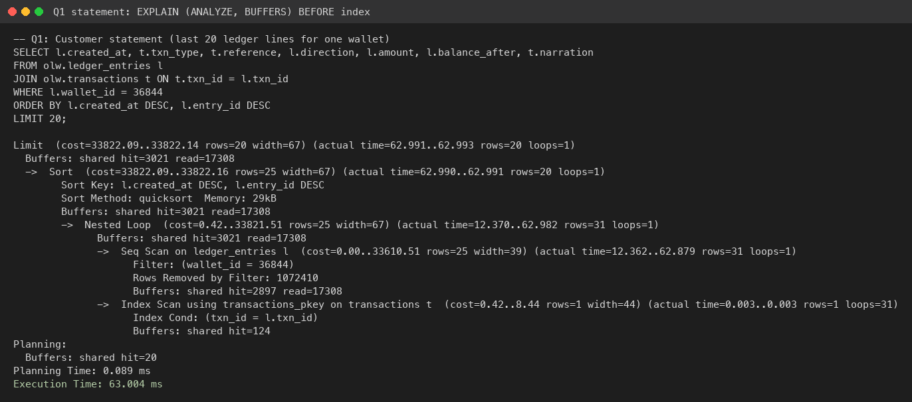
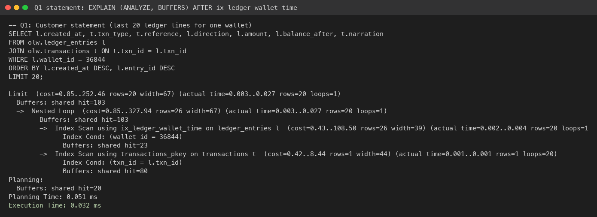

# Portfolio 2: Query Processing and Optimisation (7 marks)

## What the brief asks for

SQL queries, query results, execution plans, indexing or optimisation evidence, and a brief performance analysis.

## Checklist

- [x] Script that loads realistic made-up data: [`load_data.sql`](load_data.sql) (50,000 customers, 450,000 transactions, 1,072,441 ledger entries)
- [x] 8 SQL queries in [`queries.sql`](queries.sql) (joins, grouping, a statement query, report queries, an AML check, a reconciliation)
- [x] Saved results for each query: [`evidence/results/`](evidence/results/)
- [x] `EXPLAIN (ANALYZE, BUFFERS)` plans before indexes: [`evidence/plans_before/`](evidence/plans_before/)
- [x] Indexes in [`indexes.sql`](indexes.sql), and the same plans after: [`evidence/plans_after/`](evidence/plans_after/)
- [x] Before and after comparison: [`evidence/benchmark_results.md`](evidence/benchmark_results.md), produced by [`run_benchmark.py`](run_benchmark.py)
- [x] Screenshots in [`screenshots/`](screenshots/)

## How to run

```bash
psql opelatwallet -f portfolio-1-database-design/schema.sql
psql opelatwallet -f portfolio-2-query-optimisation/load_data.sql          # about 40 seconds
python3 portfolio-2-query-optimisation/run_benchmark.py                 # needs psycopg2
psql opelatwallet -f portfolio-2-query-optimisation/brin_vs_btree.sql
```

## My work

### The data

[`load_data.sql`](load_data.sql) builds a full year of activity with a fixed random seed, so every run gives the same data. It funds each wallet with an opening deposit, then posts every successful transaction as double-entry ledger lines and computes running balances. The load ends with integrity checks. All three return 0: no unbalanced transactions, no negative customer balances, and no negative running balances ([`evidence/load_data_output.txt`](evidence/load_data_output.txt)). The data is large enough that a full scan of `ledger_entries` costs about 50 ms, so good and bad plans are easy to tell apart.

### Method

Each query was run 7 times with `EXPLAIN (ANALYZE, BUFFERS)` and the **median** execution time was kept, so one slow run does not distort the result. Parallel workers were switched off so that both runs use one CPU core and compare fairly. The indexes were dropped for the "before" run and created from `indexes.sql` for the "after" run.

### Results

| Query | Purpose | Before (ms) | After (ms) | Speed-up | What changed in the plan |
|---|---|---|---|---|---|
| Q1 | Customer statement, last 20 lines | 62.2 | 0.033 | ~1,900x | Seq Scan of 1.07M ledger rows became an Index Scan on `(wallet_id, created_at DESC)` that stops after 20 rows |
| Q2 | Find a caller from the last 6 phone digits | 3.86 | 0.22 | ~18x | Seq Scan became a trigram GIN Bitmap Index Scan |
| Q3 | Transactions stuck in `pending` | 42.4 | 0.004 | ~10,600x | Seq Scan became an Index Scan on a 16 kB partial index |
| Q4 | Daily volume report, one month | 60.2 | 24.3 | 2.5x | Seq Scan became a BRIN Bitmap Heap Scan that reads only October's blocks |
| Q5 | AML check, last 7 days | 54.5 | 15.2 | 3.6x | Same BRIN index narrows the scan to one week |
| Q6 | Reconciliation, balance vs ledger | 417.0 | 452.9 | none | Still two Seq Scans (expected, see below) |
| Q7 | Top billers, one month | 45.2 | 2.9 | 15.5x | Seq Scan became an **Index Only Scan** on a partial covering index |
| Q8 | Look up one transaction by reference | 0.003 | 0.004 | none | Already an Index Scan on the UNIQUE constraint |

Full numbers: [`evidence/benchmark_results.md`](evidence/benchmark_results.md).

**Q1 before:** PostgreSQL reads every ledger row and throws away 1,072,410 of them to find 31.



**Q1 after:** the composite index returns the rows already in the right order, so the sort disappears too.



### Analysis

1. **Match the index to the query's filter and sort order.** Q1 filters by `wallet_id` and sorts by `created_at DESC`. An index on `wallet_id` alone would still need a sort. The composite index `(wallet_id, created_at DESC, entry_id DESC)` gives rows in the final order, so the `LIMIT 20` stops early. This is the most frequent query in a wallet app, so it deserves the 41 MB index.
2. **A leading wildcard needs a different index type.** `LIKE '%012345'` cannot use a B-tree, because a B-tree is sorted from the first character. A trigram (pg_trgm) GIN index breaks the phone number into 3-character pieces and can match any part of it.
3. **Partial indexes are tiny when you only care about a few rows.** Only 8 of 450,000 transactions are pending. The partial index holds just those rows (16 kB), so the operations alert is almost free to run every minute.
4. **BRIN suits append-only time data.** Transactions are inserted in time order, so each block of the table covers a narrow time window. BRIN stores only the minimum and maximum time per 32 blocks: **24 kB against 9.9 MB for a B-tree** on the same column. Even with the B-tree available, the planner chose the BRIN index for Q4 ([`evidence/brin_vs_btree_output.txt`](evidence/brin_vs_btree_output.txt)). The plan shows "lossy" heap blocks and 3,809 rows removed by recheck. This is the price of BRIN: it is approximate, so PostgreSQL rechecks each row.
5. **Covering indexes avoid the table.** Q7's index stores `created_at`, `biller_id` and (via `INCLUDE`) `amount` for successful bill payments only. Everything the query needs is in the index, so it becomes an Index Only Scan.
6. **Some queries should not be indexed.** Q6 must read every ledger row to check every wallet, so no index can help, and the small change in time is just noise. The right fix is architectural: run it at night on a read replica (Portfolio 5), so it never slows down customers.
7. **Indexes have a cost.** Every index makes inserts slower and uses disk space. `ix_ledger_wallet_time` (41 MB) is bigger than the transactions BRIN index by a factor of over 1,000. It is worth it only because statements are the most common read. A new index should be added only when a real query needs it.
