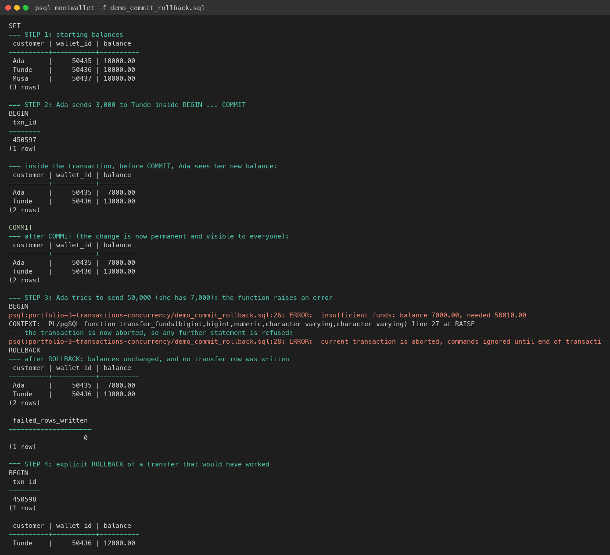
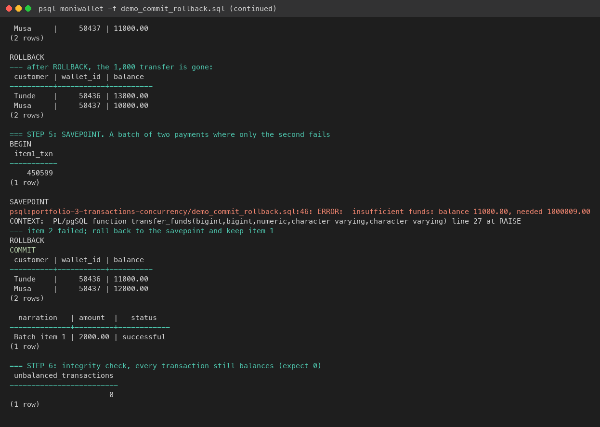
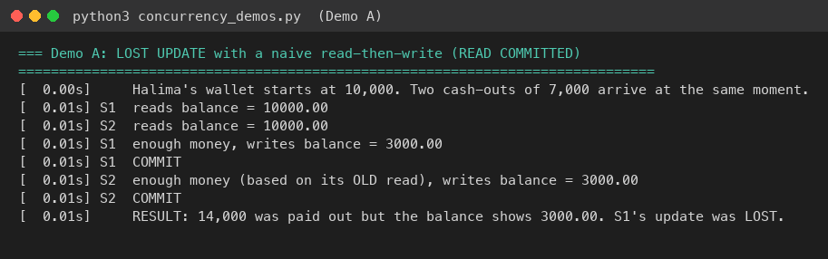
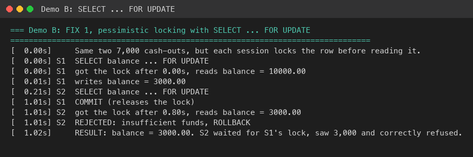
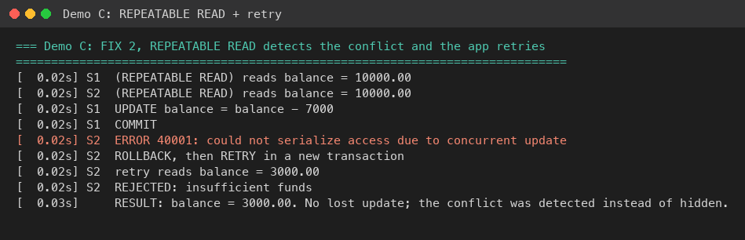
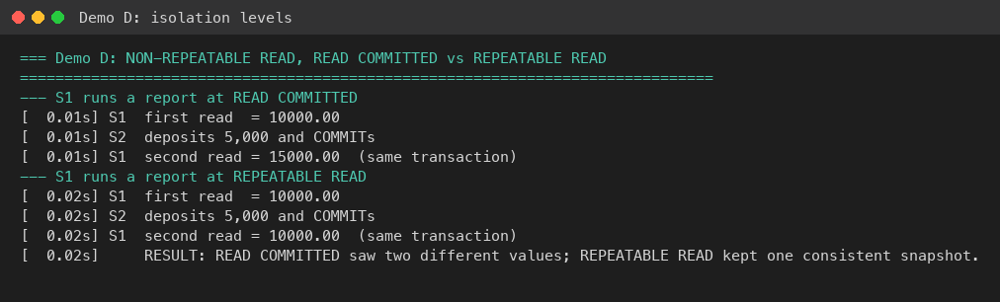
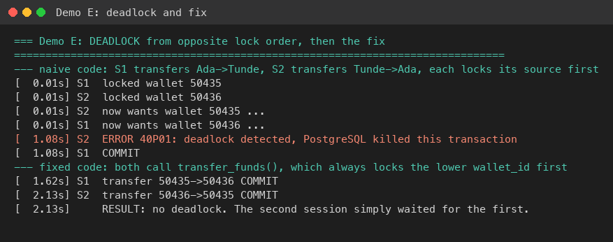
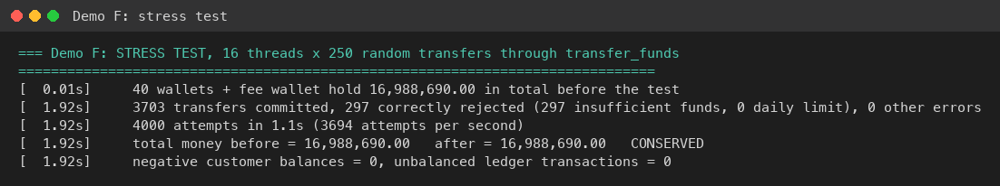

# Portfolio 3: Transactions and Concurrency (7 marks)

## What the brief asks for

Transaction examples showing commit, rollback, isolation, a concurrency issue or control mechanism, and screenshots or output evidence.

## Checklist

- [x] A wallet transfer done as one transaction that commits: [`transfer_function.sql`](transfer_function.sql), step 2 of [`demo_commit_rollback.sql`](demo_commit_rollback.sql)
- [x] A failing transfer that rolls back (not enough balance), with balances checked before and after: step 3
- [x] SAVEPOINT: a batch where one item fails and the others are kept: step 5
- [x] An isolation level demo (READ COMMITTED compared with REPEATABLE READ): Demo D
- [x] A concurrency problem with two sessions side by side (lost update): Demo A
- [x] The fixes: `SELECT ... FOR UPDATE` (Demo B), REPEATABLE READ with retry (Demo C), deadlock prevention by lock ordering (Demo E)
- [x] A stress test with 16 concurrent threads: Demo F
- [x] Output saved in [`evidence/`](evidence/) and screenshots in [`screenshots/`](screenshots/)

## How to run

```bash
psql moniwallet -f portfolio-3-transactions-concurrency/transfer_function.sql     # function + 5 demo wallets (resets them)
psql moniwallet -f portfolio-3-transactions-concurrency/demo_commit_rollback.sql
python3 portfolio-3-transactions-concurrency/concurrency_demos.py                 # needs psycopg2
psql moniwallet -f portfolio-3-transactions-concurrency/transfer_function.sql     # reset the demo wallets afterwards
```

Demos A to E change the demo wallets' balances directly (that is the point of showing what goes wrong), so the last command removes them again. After the reset, the Portfolio 2 reconciliation query (Q6) returns 0 rows.

## My work

### The transfer function

`transfer_funds(from, to, amount)` is the only way the app moves money between wallets. Inside one database transaction it:

1. locks **both** wallets with `SELECT ... FOR UPDATE`, always in `wallet_id` order;
2. checks, *after* locking, that both wallets are active, the sender has enough money (amount + ₦10 fee above ₦5,000) and the daily limit is not exceeded;
3. inserts the transaction, updates both balances, and writes the double-entry ledger lines (plus a fee line to the fee income wallet).

If any check fails it raises an exception, and PostgreSQL undoes everything done so far. This gives all four ACID properties for a transfer: **atomic** (all or nothing), **consistent** (CHECK constraints and the ledger rule still hold), **isolated** (the row locks stop other sessions interfering) and **durable** (once `COMMIT` returns, the transfer survives a crash because it is in the write-ahead log).

### Commit, rollback and savepoint



- **Step 2, COMMIT:** inside the transaction Ada already sees 7,000. Other sessions would still see 10,000 until the commit.
- **Step 3, automatic failure:** sending 50,000 with only 7,000 raises `insufficient funds`. The transaction becomes *aborted*: even `SELECT 1` is refused until `ROLLBACK`. Afterwards the balances are unchanged and **0 rows** were written for the failed transfer.
- **Step 4, manual ROLLBACK:** a valid transfer is undone because the user cancelled.
- **Step 5, SAVEPOINT:** in a batch of two payments, item 2 fails. `ROLLBACK TO SAVEPOINT` throws away only item 2, and item 1 is committed. This is how a bulk salary payment can skip one bad account without losing the rest.



### The concurrency problem: a lost update (Demo A)

Two cash-outs of 7,000 hit a wallet holding 10,000 at the same moment. Each session reads 10,000, decides there is enough, and writes `10000 - 7000`. The final balance is 3,000, but **14,000 was paid out**. The first update was silently overwritten. READ COMMITTED (PostgreSQL's default) does not prevent this when the application reads a value and writes back a computed value.



### Fix 1: pessimistic locking (Demo B)

With `SELECT ... FOR UPDATE`, the second session **waits 0.8 s** for the first to commit, then reads the new balance (3,000) and correctly refuses. This is what `transfer_funds` uses, because for money the safest choice is to wait.



### Fix 2: optimistic control with REPEATABLE READ (Demo C)

At REPEATABLE READ the second session's update fails with **`40001 could not serialize access due to concurrent update`**. Nothing is overwritten; the application catches the error, retries in a new transaction, sees 3,000 and refuses. This avoids waiting on locks, but the application *must* have retry logic.



### Isolation levels compared (Demo D)

A report reads one balance twice while another session deposits 5,000 in between. At **READ COMMITTED** the two reads give 10,000 and 15,000 (a *non-repeatable read*). At **REPEATABLE READ** both reads give 10,000, because the transaction works on one snapshot taken at its start (PostgreSQL's MVCC). Reports that add up many rows, such as the daily reconciliation, should run at REPEATABLE READ so all their numbers come from the same moment.



### Deadlock and how lock ordering prevents it (Demo E)

Naive code that locks "my wallet first" deadlocks when Ada pays Tunde while Tunde pays Ada: each holds the lock the other needs. PostgreSQL detects this after about 1 second (`deadlock_timeout`) and kills one transaction (**`40P01`**). `transfer_funds` always locks the lower `wallet_id` first, so both sessions queue for the same lock and the second simply waits. No deadlock is possible.



### Stress test (Demo F)

16 threads each made 250 random transfers between 40 wallets at the same time: **4,000 attempts in about 1.1 s**.

| Check | Result |
|---|---|
| Transfers committed | 3,703 |
| Correctly rejected (insufficient funds) | 297 |
| Unexpected errors (including deadlocks) | 0 |
| Total money before and after | 16,988,690.00 = 16,988,690.00 (**conserved**) |
| Negative customer balances | 0 |
| Unbalanced ledger transactions | 0 |



### What I learned

- The default isolation level does **not** protect a read-then-write pattern. Either lock the row (`FOR UPDATE`), write relative updates (`balance = balance - 7000`), or use a stricter level and retry.
- Pessimistic locking is simpler and right for a single hot wallet. Optimistic control (REPEATABLE READ or SERIALIZABLE) scales better when conflicts are rare, but every caller needs retry code.
- Deadlocks are a design bug, not bad luck: a consistent lock order removes them completely.
- Checks must happen *after* the lock is taken. Checking the balance first and locking later re-opens the race.
