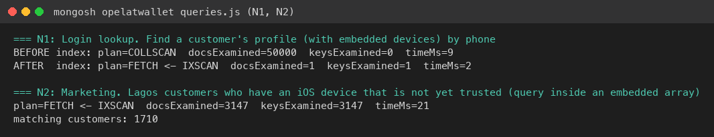
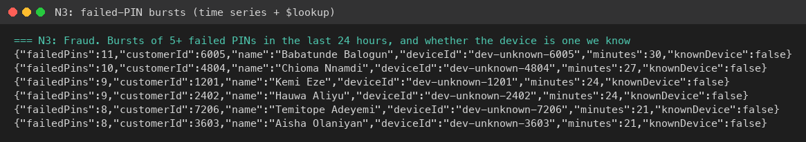
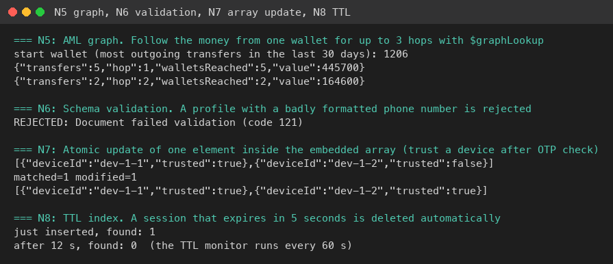
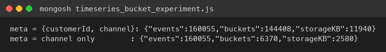

# Portfolio 4: NoSQL and Advanced Data Models (7 marks)

## What the brief asks for

A NoSQL model based on the same case study, a document, key-value, column or graph example, implementation evidence, and an explanation of why it suits the data.

## Checklist

- [x] NoSQL type and the OpeLat Wallet data it holds: MongoDB 7.0, with four models (document, key-value with TTL, time series, graph)
- [x] Data model with a sample document: below and [`evidence/sample_document.json`](evidence/sample_document.json)
- [x] Scripts that create the collections, load data and run 8 queries: [`create_collections.js`](create_collections.js), [`setup_mongo.sh`](setup_mongo.sh), [`queries.js`](queries.js)
- [x] Indexes on the most searched fields, with `explain("executionStats")` before and after
- [x] Explanation: why this data fits NoSQL better than the relational design, and what is given up
- [x] Output in [`evidence/`](evidence/), screenshots in [`screenshots/`](screenshots/)

## How to run

```bash
./portfolio-5-distributed-cloud/start_mongo_replicaset.sh        # 3-node replica set on ports 27031-27033
psql opelatwallet -f portfolio-4-nosql/export_from_postgres.sql     # same customers and transfers as PostgreSQL
./portfolio-4-nosql/setup_mongo.sh                                # collections, import, generated activity
mongosh "mongodb://127.0.0.1:27031,127.0.0.1:27032,127.0.0.1:27033/opelatwallet?replicaSet=olwrs" portfolio-4-nosql/queries.js
```

## My work

### What goes in MongoDB, and what stays in PostgreSQL

Money stays in PostgreSQL. Balances and transfers need multi-row ACID transactions, foreign keys and the double-entry ledger (Portfolios 1 and 3). MongoDB holds the data around the money: things that are read as a whole, change shape over time, or arrive in very large volumes.

| Collection | NoSQL model | OpeLat Wallet data | Why not a relational table |
|---|---|---|---|
| `customer_profiles` | **Document** | Profile with embedded devices and notification settings | The login screen needs the profile *and* its devices in one read. In SQL that is a join across 2 to 3 tables on every login. Device fields differ by OS and change often. |
| `login_sessions` | **Key-value** (lookup by `_id` token) with a **TTL index** | "Remember me" sessions | Read by key only, never joined. The database deletes expired sessions itself, with no cleanup job. |
| `app_events` | **Time series** | App and USSD telemetry: logins, failed PINs, balance checks | 160,055 events in one week. Append-only, always queried by time range. |
| `transfer_edges` | **Graph** (edges, traversed with `$graphLookup`) | Who sent money to whom in the last 30 days (18,364 edges from PostgreSQL) | "Where did the money go after 3 hops?" is a recursive query. A graph traversal expresses it directly. |

All four collections use the **same customer and wallet IDs as PostgreSQL**. [`export_from_postgres.sql`](export_from_postgres.sql) exports the profiles and transfer edges straight from the relational database.

### Sample document (`customer_profiles`)

```json
{
  "_id": 12345,
  "phone": "+2348000012345",
  "name": { "first": "Nkechi", "last": "Umar" },
  "state": "Ogun", "kycTier": 2, "walletId": 12348,
  "devices": [
    { "deviceId": "dev-12345-1", "os": "Android", "model": "Redmi 12",           "trusted": true,  "firstSeen": "2025-03-10" },
    { "deviceId": "dev-12345-2", "os": "Android", "model": "Samsung Galaxy A14", "trusted": false, "firstSeen": "2025-04-19" }
  ],
  "notifications": { "sms": true, "push": false, "email": true }
}
```

**Embed or reference?** Devices are **embedded**: a customer has 1 to 3 (the validator allows at most 5), they are always read with the profile, and they mean nothing alone. Transactions are **not** embedded: there are thousands per customer, an embedded array would grow without limit, and MongoDB documents are capped at 16 MB.

**Flexible, but not schema-less.** A `$jsonSchema` validator still enforces the phone format, the KYC tier range, the OS values and the device limit (N6).

### Queries and evidence

| # | Business question | Feature shown | Result |
|---|---|---|---|
| N1 | Load a profile by phone at login | Unique index | COLLSCAN of **50,000** docs became IXSCAN of **1** doc |
| N2 | Lagos customers with an untrusted iOS device | Multikey index, `$elemMatch` inside an array | 1,710 customers, read through `ix_state_device_os` |
| N3 | Bursts of 5+ failed PINs in 24 h, from a known device? | Time series + `$group` + `$lookup` | Found exactly the 6 planted takeover patterns (8 to 11 failures in 21 to 30 min, all from **unknown** devices) |
| N4 | Logins per channel per day | Time-series aggregation with `$dateTrunc` | About 3,900 app and 2,550 USSD logins a day |
| N5 | Follow the money from one wallet for up to 3 hops | Graph traversal with `$graphLookup` | Hop 1: 5 transfers, ₦445,700. Hop 2: 2 transfers, ₦164,600 |
| N6 | Reject a profile with a bad phone number | `$jsonSchema` validation | `Document failed validation (code 121)` |
| N7 | Trust a device after an OTP check | Atomic update of one array element (`devices.$`) | `matched=1 modified=1` |
| N8 | Expire a session automatically | TTL index | Session gone after 12 s (the TTL monitor runs every 60 s) |







### A design mistake I measured and corrected: the time-series metaField

`app_events` first used `meta: {customerId, channel}`. MongoDB groups time-series events into storage *buckets* by the meta value, and there are 50,000 customers. So almost every bucket held just one event: **144,408 buckets for 160,055 events**. [`timeseries_bucket_experiment.js`](timeseries_bucket_experiment.js) copied the same events into a collection whose meta is only `channel`:

| metaField | Buckets | Storage |
|---|---|---|
| `{customerId, channel}` | 144,408 | 11,940 KB |
| `channel` only | **6,370** | **2,580 KB** (4.6x smaller) |



**Lesson:** the metaField should hold *low-cardinality* values that many events share (channel, app version, region). The customer ID belongs in the event body, with a secondary index for per-customer queries (as `ix_customer_ts` does for N3).

### Suitability: what MongoDB gives and what it costs

**Gains for this data**
- One read returns the whole profile with its devices: no joins on the login path, which runs millions of times a day.
- New device or notification fields can be added without a migration (`ALTER TABLE` on a large table can lock it).
- Time-series storage compresses append-only telemetry, and TTL indexes delete old data with no cleanup job.
- Graph traversal (`$graphLookup`) answers AML "follow the money" questions in one query.
- Replica sets give automatic failover, and sharding spreads load across servers (Portfolio 5).

**Costs, and why money stays in PostgreSQL**
- No foreign keys. Nothing stops a profile from pointing at a `walletId` that does not exist, so the application must keep the two databases consistent.
- Denormalised data can go stale. The profile copies the customer's name, so a name change must be written in both places.
- MongoDB does support multi-document transactions, but they are slower and limited. A double-entry ledger with strict constraints is what a relational database is built for.
- `$graphLookup` suits a few hops. Deep, large fraud networks would need a dedicated graph database such as Neo4j.

This is **polyglot persistence**: each kind of data goes in the store that fits it, joined by shared IDs.
