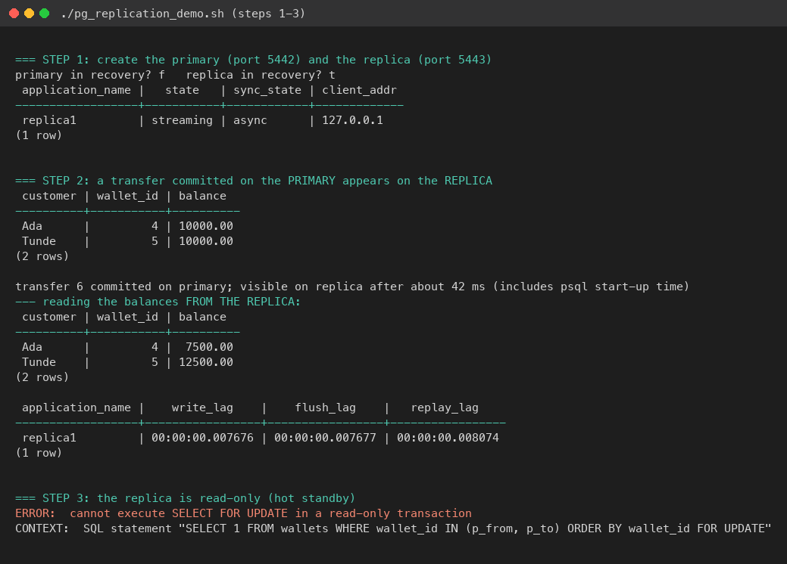
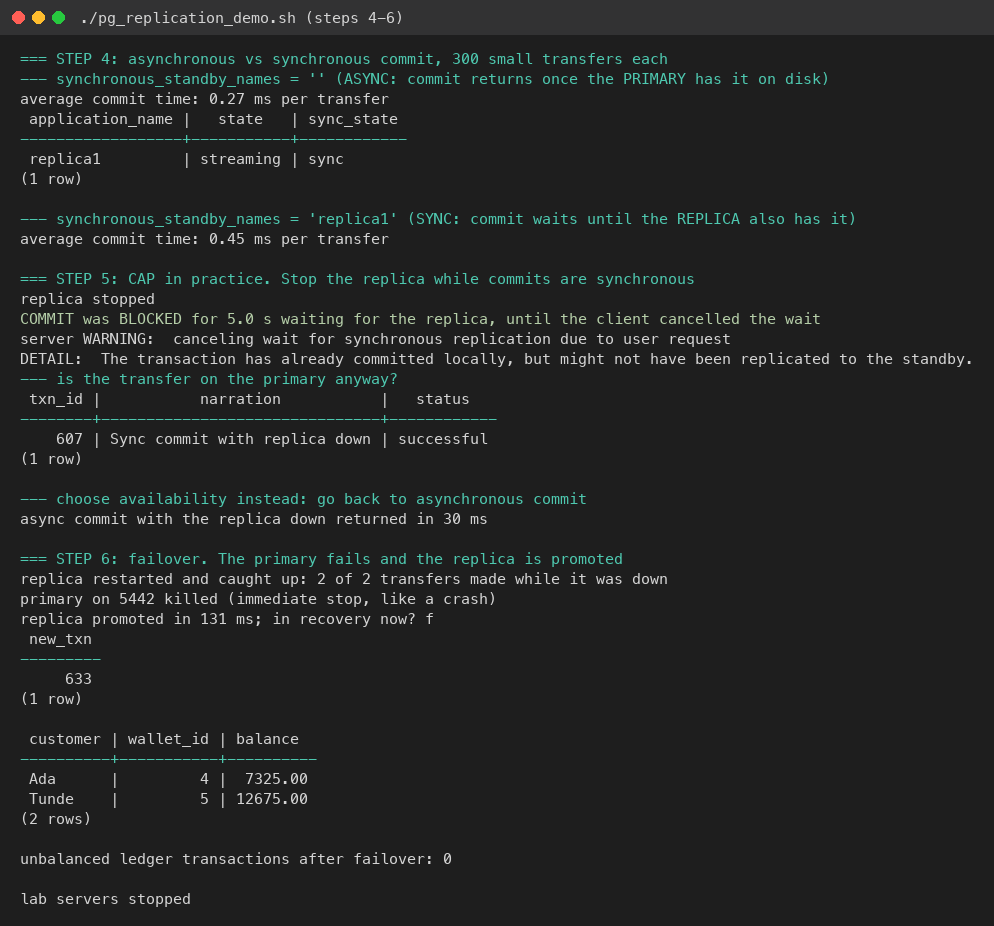
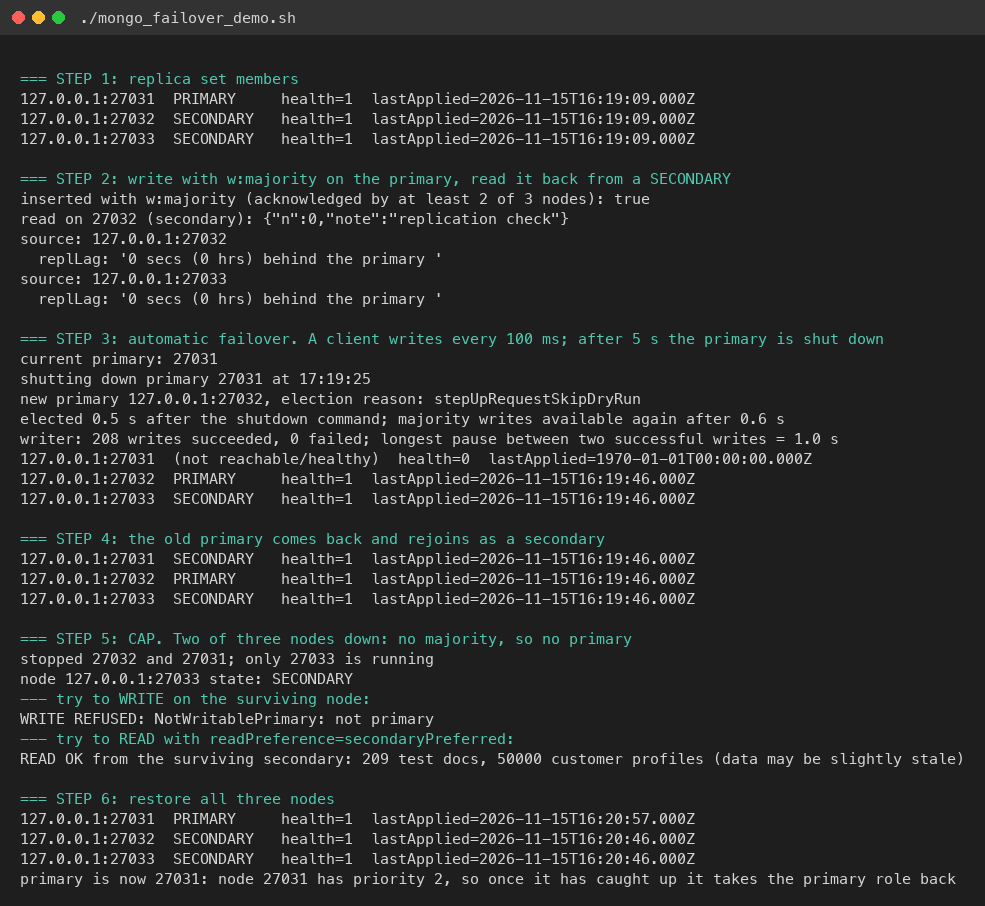
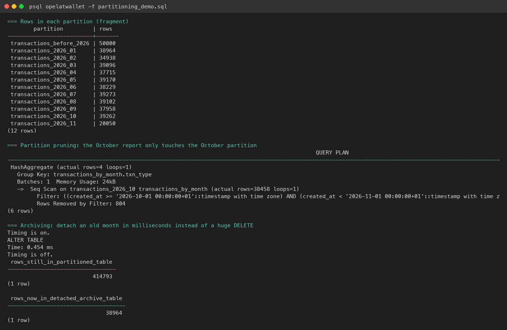
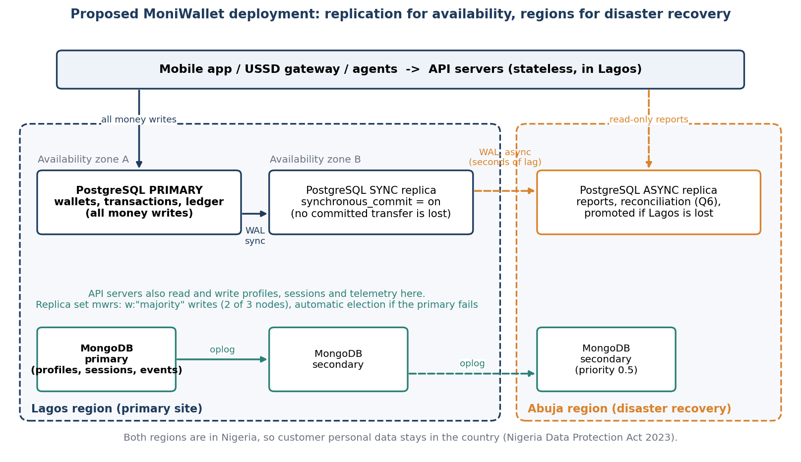

# Portfolio 5: Distributed and Cloud Database Exercise (6 marks)

## What the brief asks for

A distributed or cloud database discussion or setup based on the same case study, including replication, sharding, availability, consistency, or deployment evidence.

## Checklist

- [x] What to show: **three working setups** on one computer: PostgreSQL streaming replication (primary + hot standby), a 3-node MongoDB replica set, and monthly partitioning of the transactions table
- [x] Configuration files: [`config/primary.conf`](config/primary.conf), [`config/replica.conf`](config/replica.conf), [`config/mongod-node.conf.template`](config/mongod-node.conf.template)
- [x] Evidence: data written on the primary appears on the replica, and what happens when the primary stops: [`evidence/`](evidence/), [`screenshots/`](screenshots/)
- [x] Discussion: CAP theorem and the consistency choice for MoniWallet (below)
- [x] Proposed production deployment: [`architecture.png`](architecture.png)

## How to run

```bash
./portfolio-5-distributed-cloud/pg_replication_demo.sh        # new primary :5442 + replica :5443 in .lab/ (main server untouched)
./portfolio-5-distributed-cloud/start_mongo_replicaset.sh     # 3 MongoDB nodes on :27031-27033
./portfolio-5-distributed-cloud/mongo_failover_demo.sh
psql moniwallet -f portfolio-5-distributed-cloud/partitioning_demo.sql
```

Docker was not running on this computer, so every node runs as a normal process with its own data folder in `.lab/` (ignored by git). The behaviour is the same as with containers or separate servers, but all nodes share one machine, so network delays are much smaller than between real data centres.

## My work

### A. PostgreSQL streaming replication ([`pg_replication_demo.sh`](pg_replication_demo.sh))

The script creates a new primary, loads the MoniWallet schema and the `transfer_funds` function, and clones it with `pg_basebackup -R` into a hot-standby replica. The replica uses a replication slot (`replica1_slot`), so the primary keeps any WAL the replica has not received yet.

| Step | What was tested | Observed result |
|---|---|---|
| 1 | Replica connected | `state = streaming`, `sync_state = async` |
| 2 | Transfer of ₦2,500 on the primary | Visible on the replica in about 42 ms (including `psql` start-up). `replay_lag` = **8.1 ms**. Balances read from the replica: Ada 7,500, Tunde 12,500 |
| 3 | Write on the replica | `ERROR: cannot execute SELECT FOR UPDATE in a read-only transaction` |
| 4 | 300 transfers, async vs sync commit | **0.27 ms** vs **0.45 ms** per commit (sync is about 1.7x slower, even on one machine) |
| 5 | Replica stopped while commits are synchronous | `COMMIT` **blocked for 5.0 s** until the client gave up. PostgreSQL warned: "The transaction has already committed locally, but might not have been replicated". Switching back to async, the next commit took 30 ms |
| 6 | Primary killed (`stop -m immediate`), replica promoted | Promoted in **131 ms**. The first write after failover succeeded, and `v_unbalanced_transactions` = **0** |





### B. MongoDB replica set failover ([`mongo_failover_demo.sh`](mongo_failover_demo.sh))

| Step | What was tested | Observed result |
|---|---|---|
| 1 to 2 | Write with `w: "majority"`, read from a secondary | Acknowledged by 2 of 3 nodes. Read on the secondary straight away, replication lag 0 s |
| 3 | Primary shut down while a client writes every 100 ms | New primary elected **0.5 s** later, majority writes available after **0.6 s**. The client made **208 writes, 0 failed** (retryable writes); its longest pause was 1.0 s |
| 4 | Old primary restarted | Rejoined as a SECONDARY and caught up |
| 5 | Two of three nodes stopped | No majority, so no primary. Write: **`NotWritablePrimary`**. Read with `secondaryPreferred`: **OK** (209 test docs, 50,000 profiles, possibly slightly stale) |
| 6 | All nodes restored | Node 27031 (priority 2) took back the primary role once it caught up |



### C. Fragmentation: partitioning transactions by month ([`partitioning_demo.sql`](partitioning_demo.sql))

The 454,247 transactions were split into 12 range partitions (one per month of 2026, plus one for 2025). The October report's plan scans **only `transactions_2026_10`** (partition pruning). Archiving January took **0.3 ms** with `DETACH PARTITION`, instead of a `DELETE` of 38,964 rows that would bloat the table and the WAL. Each partition is also the natural unit to move to another server when the data outgrows one machine.



### CAP theorem: what MoniWallet chooses, and where

During a network partition, a distributed system must choose between **Consistency** (every read sees the latest write) and **Availability** (every request gets an answer). Both experiments show this choice happening:

- **Money (PostgreSQL ledger): choose C.** Step A5 is the CP choice. With synchronous replication, a commit waits rather than risk a transfer existing on only one server. If the primary then failed, a customer could be paid twice or lose money. For wallet balances, refusing or delaying a transfer is far better than getting it wrong. MongoDB step B5 shows the same choice: without a majority, writes are refused.
- **Everything around the money: choose A (eventual consistency, the BASE model).** Login sessions, telemetry, notification settings and the reporting replica can be a few seconds stale without harm. Reading a profile from a secondary during an outage (B5) keeps the app usable.
- **The practical balance.** Use *one* synchronous replica in a second availability zone (no committed transfer is lost if a server dies) and an *asynchronous* replica in another region for disaster recovery. With only one synchronous standby, the primary blocks if that standby fails (A5). Production setups therefore list two candidates, for example `synchronous_standby_names = 'ANY 1 (replica_az_b, replica_az_c)'`, so one healthy standby is enough.

### Sharding: when one primary is not enough

Replication copies the data; it does not spread the *writes*. If MoniWallet grew to millions of transfers an hour, the next step would be sharding:

| Store | Shard key | Why | Trade-off |
|---|---|---|---|
| PostgreSQL ledger (e.g. with the Citus extension) | `wallet_id` (hash) | A statement (Q1) and a balance update touch one shard | A transfer between wallets on two shards needs a distributed (two-phase) commit, which is slower |
| MongoDB `app_events` | hashed `meta.customerId` | Spreads write load evenly. A time-based key would send every new event to one "hot" shard | Range queries over all customers must ask every shard |
| MongoDB `customer_profiles` | hashed `_id` | Login lookups by `_id` or phone go to one shard | Lookups by other fields are broadcast to all shards |

### Proposed cloud deployment



- **Managed services** (for example Amazon RDS or Azure Database for PostgreSQL, and MongoDB Atlas) handle backups, patching, failover and monitoring. A small team should not run these by hand.
- **Both regions are in Nigeria (Lagos and Abuja),** so customer personal data stays in the country, in line with the Nigeria Data Protection Act 2023's rules on transfers abroad.
- **Targets:** RPO = 0 inside Lagos (synchronous standby). RPO of a few seconds and RTO of minutes for losing the whole Lagos region (asynchronous Abuja replica, promoted as in step A6).
- **Read scaling:** reports and the nightly reconciliation (Portfolio 2, Q6) run on the replica, so they never slow down customer transfers on the primary.
